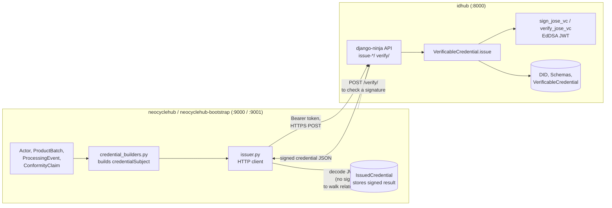
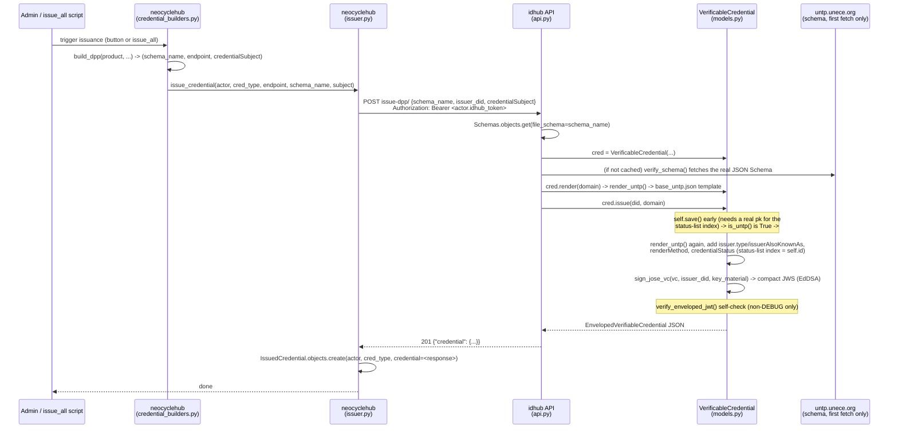

# NeoCycle UNTP v0.7.0 Demonstrator — Technical Architecture

This document explains how the demonstrator works internally: its components,
data model, API, identity/signing mechanism, and — for each use case — the
exact sequence of calls between `neocyclehub` and `idhub`, including where
`pyvckit` is and isn't involved. It complements `README.md` (overview),
`HOWTO.md` (run it), and `step_by_step.md` (click-through demo script);
this one is for understanding *why* the system behaves the way it does.

Everything described here was verified against the running system, not just
read from source — API responses were captured live, credential signatures
independently re-verified from scratch outside the app, and each use case
exercised end-to-end.

## Table of contents

1. [System overview](#1-system-overview)
2. [Components](#2-components)
3. [Actors and roles](#3-actors-and-roles)
4. [Data model](#4-data-model)
5. [Identity and trust model](#5-identity-and-trust-model)
6. [Credential format and securing mechanism](#6-credential-format-and-securing-mechanism)
7. [idhub API reference](#7-idhub-api-reference)
8. [Core sequence: issuing a credential](#8-core-sequence-issuing-a-credential)
9. [Use cases, behind the scenes](#9-use-cases-behind-the-scenes)
10. [The provenance chain mechanism](#10-the-provenance-chain-mechanism)
11. [Where pyvckit is and isn't used](#11-where-pyvckit-is-and-isnt-used)
12. [Known limitations](#12-known-limitations)
13. [Quick reference](#13-quick-reference)

---

## 1. System overview

The demonstrator simulates a four-company rare-earth-magnet recycling supply
chain, each company issuing its own UNTP v0.7.0 verifiable credentials from
its own `did:web` identity, cross-linked into one provenance graph via
`relatedDocument`. Two separate Django projects divide the work:



**Division of responsibility is strict**: `neocyclehub` never touches
cryptographic key material or signs anything. It builds credential *content*
(the business data) and asks `idhub` to sign it. `idhub` owns every `did:web`
identity, every private key, and all signing/verification logic. This is why
`neocyclehub/requirements.txt` has no `cryptography` or `jwt` dependency at
all — it's architecturally incapable of forging a credential.

## 2. Components

| Component | Tech | Port | Role |
|---|---|---|---|
| `idhub/` | Django 5.2 + django-ninja + `pyvckit` (fork) + PyJWT + `cryptography` | 8000 | DID/VC signing authority. Owns all private keys. Issues and verifies credentials. Serves `did:web` documents and status lists. |
| `neocyclehub/` | Django 5.2, no crypto deps | 9000 | Demo app, no login. Holds the fixture supply chain. Calls idhub's API to get credentials signed; stores and serves the results. |
| `neocyclehub-bootstrap/` | Same code, Bootstrap-styled UI, login required | 9001 | Independent second instance of the same app — separate database, same fixture data, own DIDs reused by label, own tokens. |

All three active services are plain Django dev servers (`runserver`) behind
Docker Compose, with `idhub`'s SQLite database bind-mounted from the host
(`idhub/db.sqlite3`, persists across container recreation) and
`neocyclehub`/`neocyclehub-bootstrap`'s databases in named Docker volumes.

## 3. Actors and roles

| Actor (`Actor.name`) | Role | Real-world function | Issues |
|---|---|---|---|
| Rare Earth Recycling Ltd. | `supplier` | Collects end-of-life WEEE, extracts NdFeB magnets | DIA, DFR, DCC, DTE, DPP |
| Rare Earth Upcycling Ltd. | `upcycler` | Separates magnets into rare-earth catalysts (two parallel processes: SSC and ECEX) | DIA, DFR, DCC, DTE, DPP |
| GreenFert Innovations SAS | `manufacturer` | Blends catalyst output into nitrogen fertilizer | DIA, DFR, DCC, DTE, DPP |
| NeoCycle Auditor | `auditor` | Issues nothing — reads and cross-verifies everyone else's credentials, walks the `relatedDocument` chain | *(none — no `idhub_token` by design)* |

Each issuing actor has its own `did:web` identity (created once, in idhub,
and referenced by `Actor.did`) and its own Bearer token (`Actor.idhub_token`)
scoping what it's authorized to sign as, in idhub. idhub itself acts as a
neutral signing authority trusted by all four — it doesn't "belong" to any
one actor.

## 4. Data model

### 4.1 neocyclehub (`supply_chain/models.py`)

| Model | Key fields | Purpose |
|---|---|---|
| `Actor` | `name`, `role`, `did`, `idhub_url`, `idhub_token`, `registered_id`, `country_code` | One supply-chain company |
| `ProductBatch` | `actor`, `name`, `gtin`, `model_number`, `batch_number`, `recycled_mass_fraction`, `upstream_source_material` | A batch of product (magnets, catalysts, fertilizer) |
| `ProcessingEvent` | `actor`, `event_type` (`MakeEvent`/`ModifyEvent`/`MoveEvent`), `input_products` (M2M), `output_products` (M2M), `event_date` | A transformation or shipment step |
| `ConformityClaim` | `actor`, `standard_name`, `standard_id`, `assessor_name`, `valid_from`/`valid_until` | A third-party certification (e.g. R2:2013) |
| `IssuedCredential` | `uuid`, `actor`, `cred_type`, `label`, `credential` (JSONField — the signed result, opaque to neocyclehub), `product`/`event`/`conformity_claim` (nullable FKs back to the source record) | The signed credential as returned by idhub, plus a link back to what it's about |

### 4.2 idhub (`idhub/models.py`)

| Model | Key fields | Purpose |
|---|---|---|
| `DID` | `did`, `type` (`WEB`/`KEY`/`WEBETH`), `key_material` (encrypted JWK), `didweb_document` | An identity idhub can sign with. `key_material` is the private key, encrypted at rest, decrypted only inside an authenticated session (see §5). |
| `Schemas` | `file_schema`, `data` (the JSON Schema itself), `context`, `is_untp` (property, derived from `data`) | A registered credential schema. The 5 real UNTP v0.7.0 schemas, fetched live from `untp.unece.org`, live here. |
| `VerificableCredential` | `type`, `issuer_did`, `subject_did`, `schema`, `json_data` (the raw `credentialSubject`), `data` (encrypted — the final signed credential), `status` (`ENABLED`/`ISSUED`/`REVOKED`/`EXPIRED`) | One issued credential. `status = REVOKED` is what the Bitstring Status List (§6) reflects. |

## 5. Identity and trust model

Every issuer identity is a `did:web` DID, e.g. `did:web:localhost:xwAgT9`.
idhub:

- Generates the Ed25519 keypair and derives the DID (`pyvckit.did.generate_keys`/`generate_did`).
- Encrypts the private key material at rest; decrypting it requires a
  session-level vault password held only in Django's cache (`KEY_DIDS`),
  set at login (or, in this demo, auto-unlocked via `DEMO_AUTODECRYPT`).
- Serves the DID document at `http://localhost:8000/<suffix>/did.json`
  (`ServeDidView`), built from `pyvckit.did.gen_did_document`, containing
  the public key (`publicKeyJwk`) that anyone — including this demonstrator's
  own verification code — resolves to check a signature.

Nothing outside idhub ever sees a private key. `neocyclehub` only ever holds
a **Bearer token** (`Actor.idhub_token`), which authorizes it to ask idhub to
sign *as* a specific `did:web` — it never receives, transmits, or stores key
material.

## 6. Credential format and securing mechanism

Every credential this demonstrator issues is a **JOSE-enveloped Verifiable
Credential** — a real, spec-conformant implementation of UNTP v0.7.0's
mandatory securing mechanism (W3C VC-JOSE-COSE), *not* the older
Data-Integrity / `Ed25519Signature2018` proof style `pyvckit` implements
natively (see §11 for why that distinction matters and where each is
actually used).

**Shape actually stored and served** (`idhub/idhub/models.py:generate_enveloped_jwt`):

```json
{
  "@context": ["https://www.w3.org/ns/credentials/v2", "https://vocabulary.uncefact.org/untp/0.7.0/context/"],
  "type": "EnvelopedVerifiableCredential",
  "id": "data:application/vc+jwt,<compact JWS>"
}
```

The `<compact JWS>` is `header.payload.signature`, where:

- **Header**: `{"alg":"EdDSA","typ":"vc+jwt","cty":"vc","kid":"<issuer did>#owner"}`
- **Payload**: the VCDM 2.0 credential itself (`@context`, `type`, `issuer`, `validFrom`, `validUntil`, `credentialSubject`, `credentialStatus`, ...), as W3C VC-JOSE-COSE `application/vc+jwt` requires. Until 2026-10-07 idhub used the VC 1.1 JWT layout instead (`{"jti", "iss", "nbf", "iat", "exp", "vc": {<credential>}}`), which UNTP tools such as the UNTP Playground cannot read. Validity is checked from the credential's `validFrom`/`validUntil`, and readers still accept the old layout.
- **Signature**: EdDSA over `header.payload`, using the issuer's Ed25519 private key.

Signing (`sign_jose_vc`) and verification (`verify_jose_vc`) are two small,
symmetric functions in `idhub/idhub/models.py` — no `pyvckit` involved in
either direction. Verification resolves the signer from the JWT's own `kid`
header against idhub's local `DID` table, so it works fully offline for demo
DIDs (no outbound HTTP needed).

### credentialStatus — revocation

Every credential's `vc.credentialStatus` is a real [W3C Bitstring Status
List](https://www.w3.org/TR/vc-bitstring-status-list/) entry:

```json
{
  "id": "http://localhost/credentials/status/19/#212",
  "type": "BitstringStatusListEntry",
  "statusPurpose": "revocation",
  "statusListIndex": 212,
  "statusListCredential": "http://localhost/credentials/status/19/"
}
```

`statusListIndex` is the credential's own database `id` — the same indexing
convention idhub's older `RevocationBitmap2022` DID-document service entry
already used, so both stay consistent. `compute_status_bitstring(did)`
(`idhub/idhub/models.py`) is the single source of truth for the bitstring —
it builds a 131,072-bit (16KB minimum, for herd privacy) bitstring from
`VerificableCredential.objects.filter(status=REVOKED)` — and is shared by
two consumers:

- `ServeBitstringStatusListView` (`idhub/idhub/views.py`) GZIP-compresses and
  base64url-encodes it and serves it as its own JOSE-signed credential
  (`BitstringStatusListCredential`), for any external verifier.
- `verify_jose_vc()` (UC-6) calls it directly, in-process, to check a single
  bit — no HTTP round trip to idhub's own endpoint — so credential
  verification actually enforces revocation, not just signature validity.

Revoking a credential in idhub's admin flips its bit immediately for both
consumers, no republish step.

## 7. idhub API reference

Base URL: `http://idhub:8000/api/v1/` (from inside the Docker network) /
`http://localhost:8000/api/v1/` (from the host). Auth: `Authorization: Bearer <token>`
(`DatabaseTokenAuth`, checked against `webhook.models.Token`), except `verify/` which is public.

| Endpoint | Method | Auth | Payload | Response | Used by |
|---|---|---|---|---|---|
| `issue-dpp/` | POST | Bearer | `{schema_name, issuer_did, credentialSubject: {...}}` | `{credential: {...}}` | `build_dpp()` → `issue_credential()` |
| `issue-facility/` | POST | Bearer | same shape | same | `build_dfr()` |
| `issue-traceability/` | POST | Bearer | `credentialSubject` is a **list** (one event) | same | `build_dte()` |
| `issue-conformity/` | POST | Bearer | same shape | same | `build_dcc()` |
| `issue-identity-anchor/` | POST | Bearer | same shape | same | `build_dia()` |
| `verify/` | POST | none | `{credential: {...}}` | `{valid: bool, detail: str}` | `_verify_node()` — the chain-view badges |
| `credential/delete/` | POST | Bearer | `{credential: {...}}` (matched by legacy `proof.jws`) | `{deleted: bool, detail: str}` | not used by this demo (LD-Proof-era cleanup tool) |
| `object-did/create/`, `object-did/update/` | POST | Bearer | — | — | not used by this demo (product-DID management, unrelated flow) |

All five `issue-*/` endpoints funnel into one shared implementation,
`process_credential_issuance()` (`idhub/idhub/api/api.py`), which:

1. Looks up the `Schemas` row by exact `file_schema` name.
2. Builds an (unsaved) `VerificableCredential`.
3. Renders the unsecured credential and validates it against the real
   fetched JSON Schema (`pyvckit.verify.verify_schema`).
4. Calls `.issue()` — this is where signing actually happens (§8).
5. Saves and returns `{"credential": <the same object stored in idhub>}`.

There is no `/credentials/status/<did_pk>/` entry in the table above because
it's not part of the `api_v1` REST API — it's a plain Django view (`idhub/idhub/urls.py`),
fetched directly by any credential verifier as a resource URL, not called by
`neocyclehub` at all today.

## 8. Core sequence: issuing a credential

This is the shared backbone every "issue a DPP/DTE/DCC/DFR/DIA" use case in
§9 follows — only the payload-building step (`build_*`) differs.



## 9. Use cases, behind the scenes

For each, "trigger" is how it's actually invoked in this demo (the dashboard
"Issue" button, or `manage.py issue_all`, which does the same thing for every
actor in dependency order).

### UC-1: Issue Digital Identity Anchor (DIA)

- **Actor**: any issuing company (once each).
- **Trigger**: `Command._issue_dia()` / dashboard "Issue DIA".
- **Builder**: `build_dia(actor, registrar_did, registrar_name, registrar_url)` — anchors the actor's corporate identity: `credentialSubject.id = actor.did`, `registeredId` (LEI or registered ID), `idScheme` (defaults to GLEIF), and a `registrar` block (defaults `did:web:insee.fr` / INSEE).
- **idhub endpoint**: `issue-identity-anchor/`, credential type `["VerifiableCredential", "DigitalIdentityAnchor"]`.
- **Nothing links to it** via `relatedDocument` — it's a leaf, referenced only implicitly (every other credential's `issuer.id` is the same DID this anchors).

### UC-2: Issue Digital Facility Record (DFR)

- **Trigger**: `Command._issue_dfr()`.
- **Builder**: `build_dfr(actor, form)` — a fixed/placeholder facility (Paris coordinates, NACE process code) `operatedByParty`-linked to the actor's DID. Self-signed: `issuer_did_obj = issuer_did` in `api.py:issue_facility_credential` (the actor vouches for its own facility — commented in `api.py` as a known simplification: *"This is self_signing, should another reputable did sign this?"*).

### UC-3: Issue Digital Conformity Credential (DCC)

- **Trigger**: `Command._issue_dcc()`, one per `ConformityClaim` fixture (e.g. R2:2013 for the Recycler, ISO 14001 for the Upcycler, EU Fertilising Products Regulation for GreenFert).
- **Builder**: `build_dcc(claim, public_url)` — `assessedPerformance: [{"score": {"code": "pass"}}]`, referencing the standard and the assessed actor.
- Not itself linked into the DPP/DTE `relatedDocument` chain in this demo, though the schema supports it (a DPP could reference its DCC via `conformityClaim`).

### UC-4: Issue Digital Traceability Event (DTE)

- **Trigger**: `Command._issue_dte(event)`, called by `_issue_chain()` only once every one of the event's `input_products` already has an issued DPP.
- **Builder**: `build_dte(event, public_url)` — shape depends on `event.event_type`:
  - `MakeEvent`: `inputProduct`/`outputProduct`/`madeAtFacility`.
  - `ModifyEvent`: `modifiedProduct` (inputs+outputs combined)/`modifiedAtFacility`.
  - `MoveEvent`: `movedProduct`/`fromFacility`/`toFacility`.
  - Always looks up each input/output product's **most recently issued DPP** and adds a `relatedDocument` entry pointing at it — this is the mechanism that stitches credentials from *different companies* into one graph (§10).
- **idhub endpoint**: `issue-traceability/` — note the payload is a **list** (`[subject_event]`), not a single object, matching `IssueTraceabilityPayload.credentialSubject: List[Dict]`.

### UC-5: Issue Digital Product Passport (DPP)

- **Trigger**: `Command._issue_dpp(product)`, right after the DTE that produced it (or standalone, for raw/root materials with no producing event).
- **Builder**: `build_dpp(product, public_url, related_documents)` — `credentialSubject.type = ["Product"]`, `id = product.gtin`, `materialProvenance` (recycled content %), optional `characteristics.upstreamProcess`, and `relatedDocument` pointing *back* at the DTE(s) that produced it (the reverse direction of UC-4's link).
- This is the credential type most third parties will inspect first; §6 shows its exact wire shape.

### UC-6: Verify a credential's signature

- **Trigger**: automatic, every time the chain view (`credential_chain.html`) renders a node; also directly callable via `POST /api/v1/verify/`.
- **Flow**: `neocyclehub`'s `_verify_node(cred)` POSTs the *entire stored credential* (opaque JSON, whatever shape it's in) to idhub's public `verify/` endpoint.
- **Inside idhub** (`verify_credential_api`): detects `type == "EnvelopedVerifiableCredential"` and routes to `verify_jose_vc()`, which:
  1. Extracts the JWT from `id`.
  2. Reads `kid` from the (unverified) header to identify the claimed issuer DID.
  3. Looks up that `DID` in idhub's own table and pulls its public key from the stored `didweb_document`.
  4. Runs `jwt.decode(..., algorithms=["EdDSA"])` — this is the actual cryptographic check.
  5. Cross-checks the JWT's `iss` claim matches the `kid`-derived DID.
  6. Reads the now-decoded `vc.credentialStatus`, parses the issuer pk out of its `statusListCredential` URL, and checks that bit via `is_status_index_revoked()` (§6) — **in-process, no HTTP round trip to itself** — so a revoked credential comes back `valid: false` with detail `"Credential has been revoked (statusListIndex ...)"`, distinct from a signature failure.
- Falls back to the pre-existing LD-Proof / `nacl` verification path (checking `proof.jws`) for anything that isn't JOSE-enveloped — this demonstrator doesn't issue that shape, but the branch exists for backward compatibility. That fallback does not check revocation status.
- **No `pyvckit` involved** in verifying UNTP credentials — only in the legacy fallback branch.

### UC-7: Walk the provenance chain

- **Trigger**: "View chain" button, any credential.
- **Entirely local to neocyclehub** — no idhub call for the graph traversal itself (only per-node signature checks, UC-6, which do call idhub):
  1. `_credential_subject(credential)` decodes the JWT payload **without verifying the signature** (this step only needs to *read* `vc.credentialSubject`, not authenticate it — authentication is UC-6's job, kept separate).
  2. Reads `credentialSubject.relatedDocument`, extracts each `linkURL`'s trailing UUID.
  3. Looks up that UUID in `IssuedCredential` (same database — cross-company only in the sense that the *actor* differs, not the storage) and recurses.
  4. A `linkURL` whose UUID isn't found locally renders as an `EXT` (external/unresolvable) leaf rather than failing — this is what happens if a link points at a credential that was deleted or never issued.

### UC-8: Revoke a credential and observe the status list change

- **Trigger**: idhub admin → the credential → Revoke (`RevokeCredentialsView`, `admin/credentials/<pk>/revoke/`).
- **Effect**: `VerificableCredential.status = REVOKED`. Nothing else is touched — no separate revocation record, no republishing step.
- **Observed via**: the next `GET /credentials/status/<issuer-did-pk>/` request recomputes the bitstring from scratch (§6) and the credential's bit is now set — no separate republish step. `verify_jose_vc()` (UC-6) picks this up immediately too, since it computes the same bitstring in-process rather than trusting a cached value; the chain view's badge for that credential flips from "✓ verified" to "✗ INVALID — Credential has been revoked" on the very next page load.

**Worked example** — this is the actual sequence run against this demo to
confirm the mechanism, not a hypothetical. `POST /api/v1/verify/` with the
same credential body, before and after:

```bash
curl -s -X POST http://localhost:8000/api/v1/verify/ \
  -H "Content-Type: application/json" \
  -d '{"credential": {"@context": ["https://www.w3.org/ns/credentials/v2"],
       "type": "EnvelopedVerifiableCredential",
       "id": "data:application/vc+jwt,<the credential'"'"'s JWT>"}}'
```

Before revocation:
```json
{"valid": true, "detail": "Signature valid (DID: did:web:localhost:xwAgT9)"}
```

Revoke it (idhub admin UI, or equivalently `manage.py shell` for a quick check):
```python
vc = VerificableCredential.objects.get(pk=223)
vc.status = VerificableCredential.Status.REVOKED
vc.save()
```

Exact same request, no republish step, no cache to clear:
```json
{"valid": false, "detail": "Credential has been revoked (statusListIndex 223)"}
```

Setting `vc.status` back to `ISSUED` and re-running the request returns
`"valid": true` again immediately — the status check has no persisted
state of its own to go stale; it's recomputed from `VerificableCredential.status`
on every single verification call.

## 10. The provenance chain mechanism

`relatedDocument` links are **bidirectional by construction**, not by a
shared graph structure — each side is populated independently when *that*
side is issued:

- A **DTE** issued after its inputs' DPPs exist adds `relatedDocument` entries
  pointing at those DPPs (UC-4).
- A **DPP** issued after its producing DTE exists adds a `relatedDocument`
  entry pointing back at that DTE (UC-5).

`Command._issue_chain()` (`neocyclehub/supply_chain/management/commands/issue_all.py`)
is what makes this work without manual ordering: it repeatedly scans for
events whose inputs are all already-DPP'd, issues that event's DTE, then
immediately issues the DPPs for whatever it produced — unblocking the next
event in a topological-sort fashion. This is why running `issue_all` (or
clicking through the dashboard in the documented order) produces a fully
linked chain, while issuing credentials out of order produces the same
`EXT`/broken-link symptom described in UC-7.

The full chain, as actually observed end-to-end on a clean run:

```
Green Fertilizer DPP (GreenFert)
  -> Fertilizer Blending DTE (GreenFert)
       -> FeNd Alloy DPP (Upcycler)
            -> SSC Chlorination DTE (Upcycler)
                 -> Crushed NdFeB Granulate DPP (Recycler)
                      -> WEEE Collection DTE (Recycler)
```

Six hops, three companies, each with its own key — and every `->` above is a
`relatedDocument` link resolved and independently signature-checked live, not
a precomputed or cached tree.

## 11. Where pyvckit is and isn't used

This is worth stating explicitly, since it's easy to assume a `pyvckit`
dependency means it signs everything — it doesn't, for this demonstrator.

| Task | Library actually used |
|---|---|
| Generate an Ed25519 keypair | `pyvckit.did.generate_keys` |
| Derive a `did:web` string from a key | `pyvckit.did.generate_did` |
| Build a DID document (`verificationMethod`, etc.) | `pyvckit.did.gen_did_document` |
| Resolve a `did:web` string to its document URL | `pyvckit.did.resolve_did_url` |
| **Sign a UNTP credential (DPP/DTE/DCC/DFR/DIA)** | **`idhub.models.sign_jose_vc`** — EdDSA JWT, no pyvckit |
| **Verify a UNTP credential's signature** | **`idhub.models.verify_jose_vc`** — no pyvckit |
| Sign/verify the older Data Integrity (`Ed25519Signature2018`) shape, for any *non*-UNTP schema idhub might also serve | `pyvckit.sign.sign` / `pyvckit.verify.verify_signature` — present in the codebase, exercised by idhub's own test-suite fixtures, **not reachable by anything this demonstrator issues** (every credential type here is UNTP-typed, and `VerificableCredential.issue()` routes UNTP-typed credentials to the JOSE path exclusively) |
| Validate a credential against its JSON Schema | `pyvckit.verify.verify_schema` — used regardless of securing mechanism |

In short: **pyvckit manages identities (keys, DIDs); it does not sign or
verify any credential this demonstrator actually issues.** That split was a
deliberate compliance fix (UNTP v0.7.0 mandates JOSE/VC-JOSE-COSE securing,
not pyvckit's native Data Integrity proof — see UNTP's
[VerifiableCredentials](https://untp.unece.org/docs/specification/VerifiableCredentials/)
specification page) applied on top of what was originally an all-pyvckit
signing path.

## 12. Known limitations

Worth knowing before treating this as a production reference:

- **`issue-facility/` is self-signed** — an actor's Facility Record is
  attested by the actor itself, not an independent auditor, which the code's
  own comment flags as a simplification.
- **Schema upload's duplicate-detection now works correctly** (fixed — it
  used to compare the wrong field and silently allow duplicate `Schemas`
  rows on a second run); nothing else in this list depends on that having
  been broken.
- **DIDs and schemas are not reset by `docker compose down -v`** — that only
  clears `neocyclehub`'s named volumes. idhub's SQLite file is a host bind
  mount; see `HOWTO.md`'s troubleshooting section for how to reset it too.

## 13. Quick reference

**Ports**: idhub `8000`, neocyclehub `9000`, neocyclehub-bootstrap `9001`.

**Key files**:

| What | Where |
|---|---|
| Credential signing/verification (JOSE) | `idhub/idhub/models.py` — `sign_jose_vc`, `verify_jose_vc` (includes revocation check), `VerificableCredential.issue`/`generate_enveloped_jwt`/`verify_enveloped_jwt` |
| Status list (compute / serve) | `idhub/idhub/models.py::compute_status_bitstring`/`is_status_index_revoked`; served at `idhub/idhub/views.py::ServeBitstringStatusListView` |
| idhub REST API | `idhub/idhub/api/api.py`, schemas in `idhub/idhub/api/schemas.py` |
| DID document serving | `idhub/idhub/views.py::ServeDidView` / `ServeDidRegistryView` |
| neocyclehub payload builders | `neocyclehub/supply_chain/credential_builders.py` |
| neocyclehub → idhub HTTP client | `neocyclehub/supply_chain/issuer.py` |
| Dependency-ordered bulk issuance | `neocyclehub/supply_chain/management/commands/issue_all.py` |
| Chain-walking + verification badges | `neocyclehub/supply_chain/views.py` — `_build_chain`, `_verify_node`, `_credential_subject` |

**Credential type → idhub endpoint**:

| Type | Endpoint | credentialSubject shape |
|---|---|---|
| DPP | `issue-dpp/` | object |
| DFR | `issue-facility/` | object |
| DTE | `issue-traceability/` | **list** (one event) |
| DCC | `issue-conformity/` | object |
| DIA | `issue-identity-anchor/` | object |
